<!--
  - SPDX-FileCopyrightText: 2026 Nexeno contributors
  - SPDX-FileCopyrightText: 2026 Azure Informatique
  - SPDX-License-Identifier: AGPL-3.0-or-later
-->
<div align="center">


# Thème Azure pour Nextcloud

### Votre Nextcloud, en version augmentée.

Clair, sombre et rapide : tout change, rien ne ralentit.

[](https://github.com/Azure-Informatique/nextcloud-azure-theme/releases/latest)
[](https://apps.nextcloud.com/apps/azure_theme)
[](#compatibilité)
[](#compatibilité)
[](LICENSE)
[](REUSE.toml)

[English](README.md) · **Français**

</div>

<picture>
  <source media="(prefers-color-scheme: dark)" srcset="src/assets/images/showcase/hero-preview-dark.webp">
  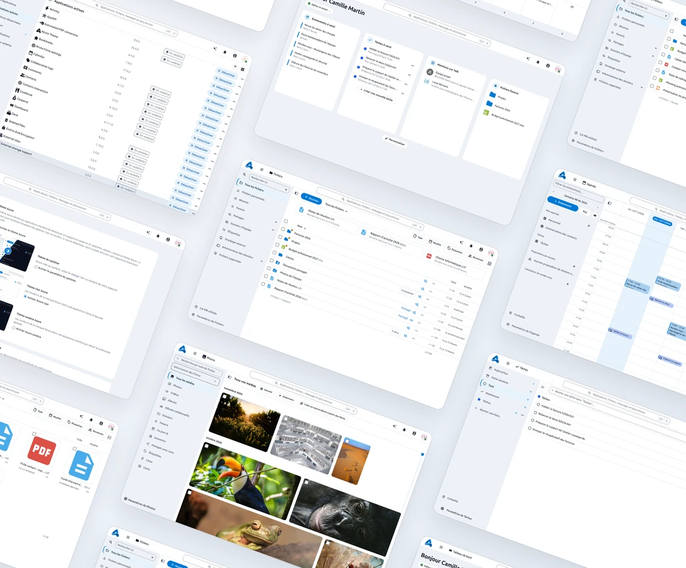
</picture>

## Points forts

- **Clair, sombre ou système** : *Azure clair*, *Azure sombre* et *Thème du système*, qui suit l'appareil et ses changements. Chacun choisit sa variante dans *Paramètres personnels → Apparence et accessibilité* ; le changement est instantané, sans recharger la page. Un administrateur peut imposer une variante à tous avec le réglage `enforce_theme` de Nextcloud.
- **Toute l'interface** : en-tête, menu des applications, navigation, fenêtres, barres latérales, recherche unifiée, notifications, pages de paramètres et de profil, magasin d'applications, connexion et double authentification, partages publics, dépôt de fichiers, formulaires et rendez-vous publics, pages invité de Talk.
- **Rapide** : aussi rapide que Nextcloud sans thème, souvent plus (voir [Performances](#performances)). Chaque page ne charge que les styles utiles ; aucun sélecteur coûteux, aucune animation au chargement.
- **Pensé pour le téléphone** : chaque écran vérifié de 1440 à 360 px, en tactile au téléphone — aucun débordement, aucun mot coupé, aucune cible tactile sous 24 px.
- **Accessible** : contrastes WCAG AA et focus clavier visible ; les thèmes à contraste élevé de Nextcloud et la police OpenDyslexic restent actifs.
- **Sûr** : API publiques de Nextcloud uniquement, aucun script en ligne, rien de chargé hors de votre serveur ; vos réglages d'apparence Nextcloud ne sont jamais modifiés, et désactiver l'app conserve tous les réglages.
- **Options d'administration** : page de connexion Azure ou standard ; entrée « Thème Azure » du menu des applications affichée ou masquée.
- **Langues** : anglais et français.

## Tour d'horizon

<table>
  <tr>
    <td width="50%"><picture><source media="(prefers-color-scheme: dark)" srcset="src/assets/images/showcase/files-dark.webp">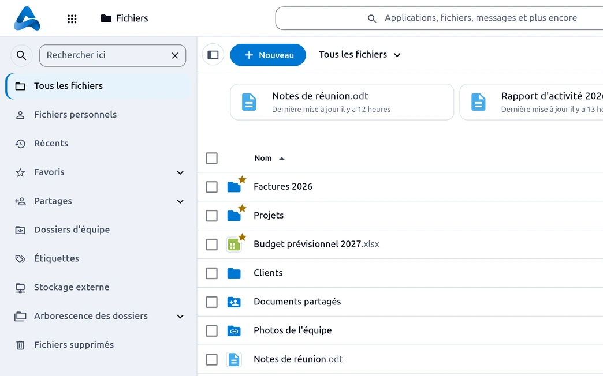</picture></td>
    <td width="50%"><picture><source media="(prefers-color-scheme: dark)" srcset="src/assets/images/showcase/photos-dark.webp">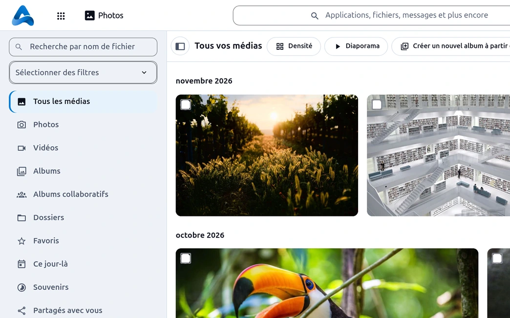</picture></td>
  </tr>
  <tr>
    <td><picture><source media="(prefers-color-scheme: dark)" srcset="src/assets/images/showcase/dashboard-dark.webp">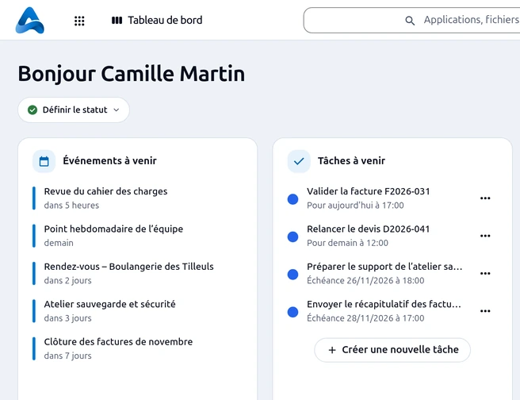</picture></td>
    <td><picture><source media="(prefers-color-scheme: dark)" srcset="src/assets/images/showcase/office-dark.webp">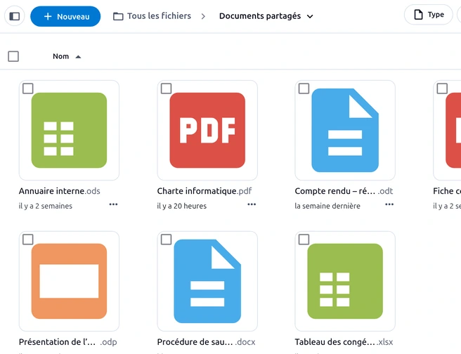</picture></td>
  </tr>
  <tr>
    <td colspan="2" align="center"><picture><source media="(prefers-color-scheme: dark)" srcset="src/assets/images/showcase/appstore-dark.webp">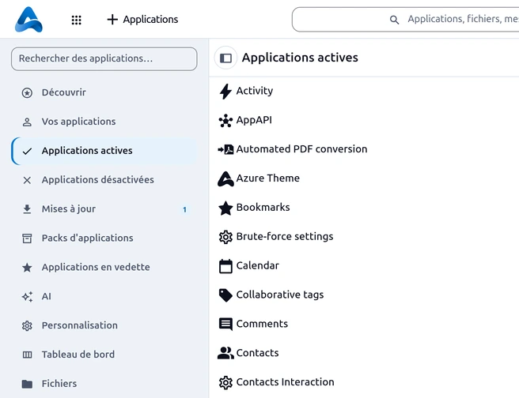</picture></td>
  </tr>
</table>

## Captures

Vraies captures de Nextcloud 34 avec le thème, en français, sur une instance de test aux données fictives.

| Clair | Sombre |
|---|---|
| 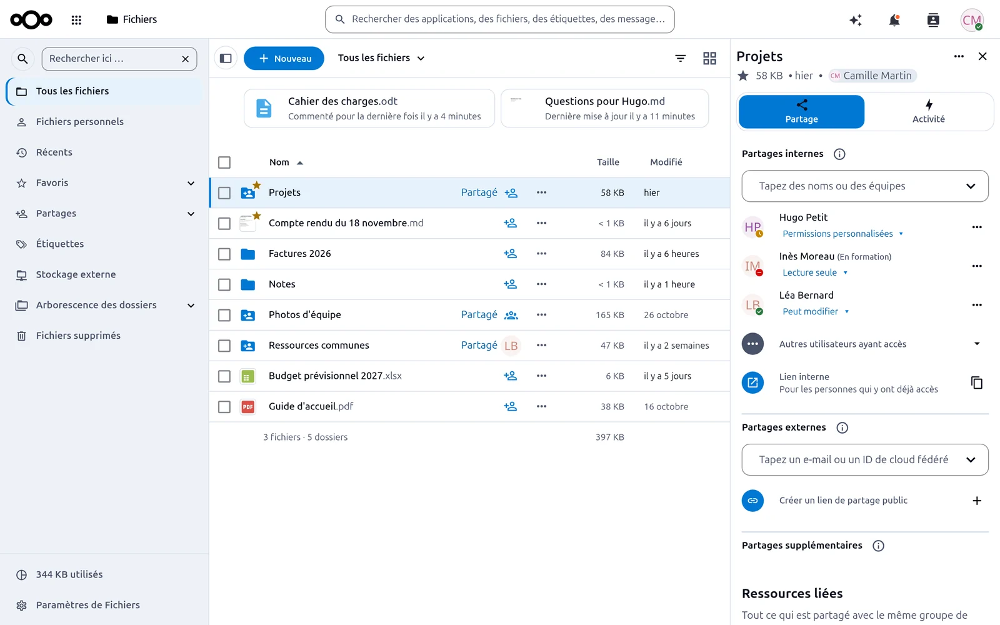 | 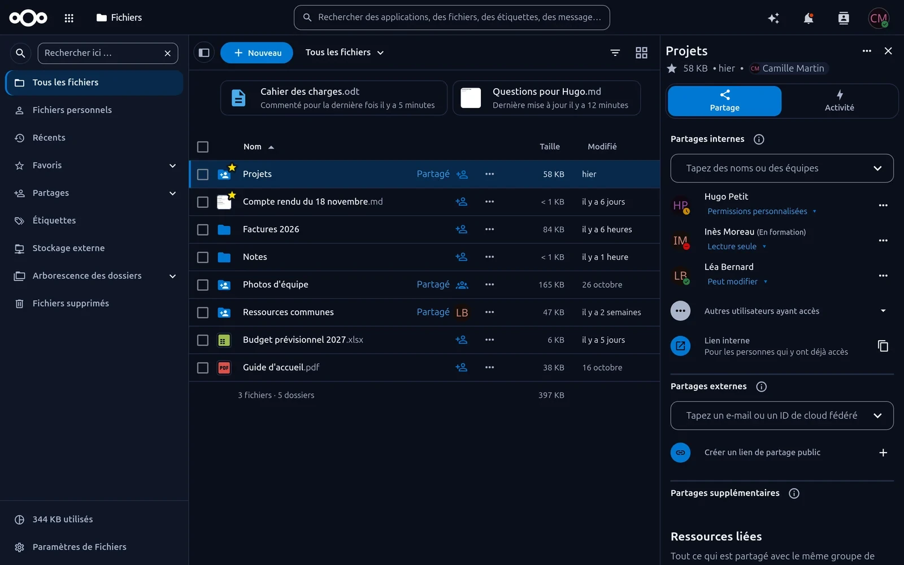 |

| | |
|---|---|
| 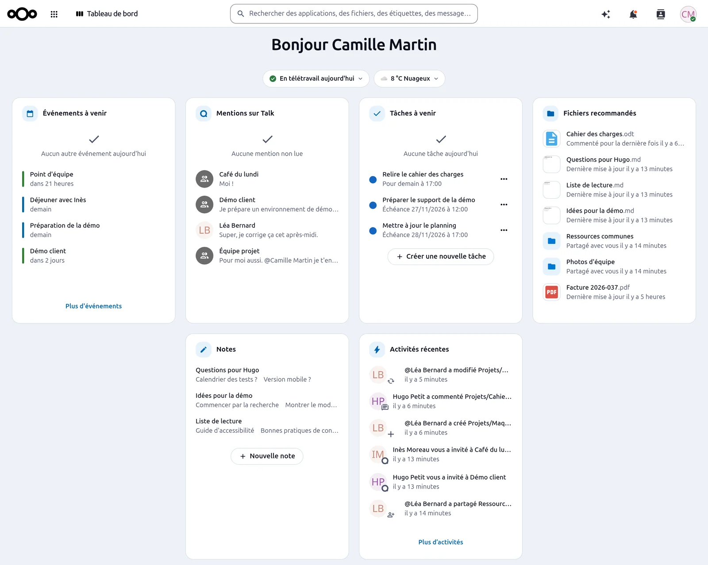 | 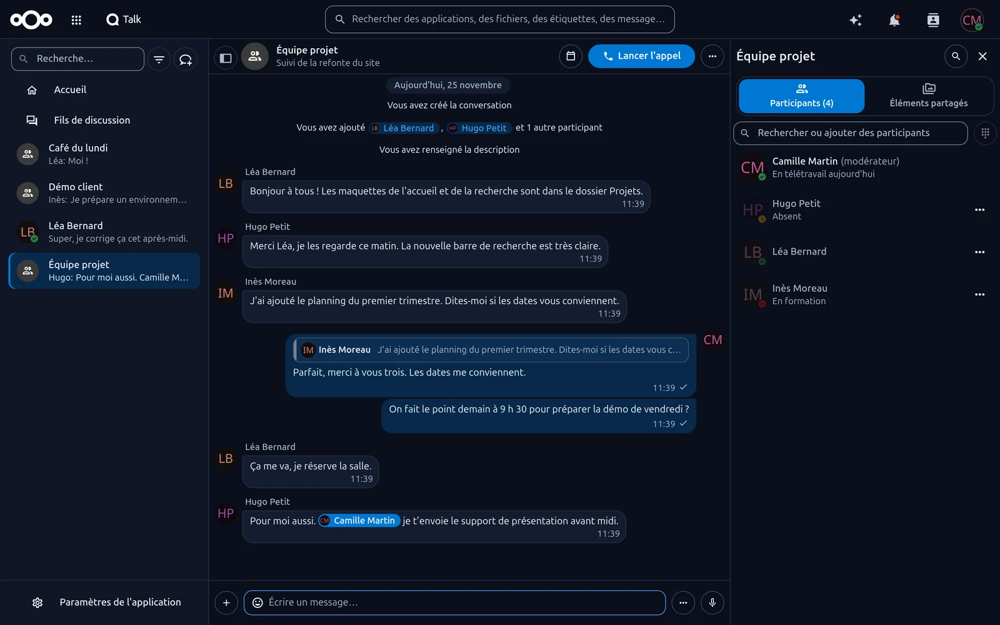 |
| 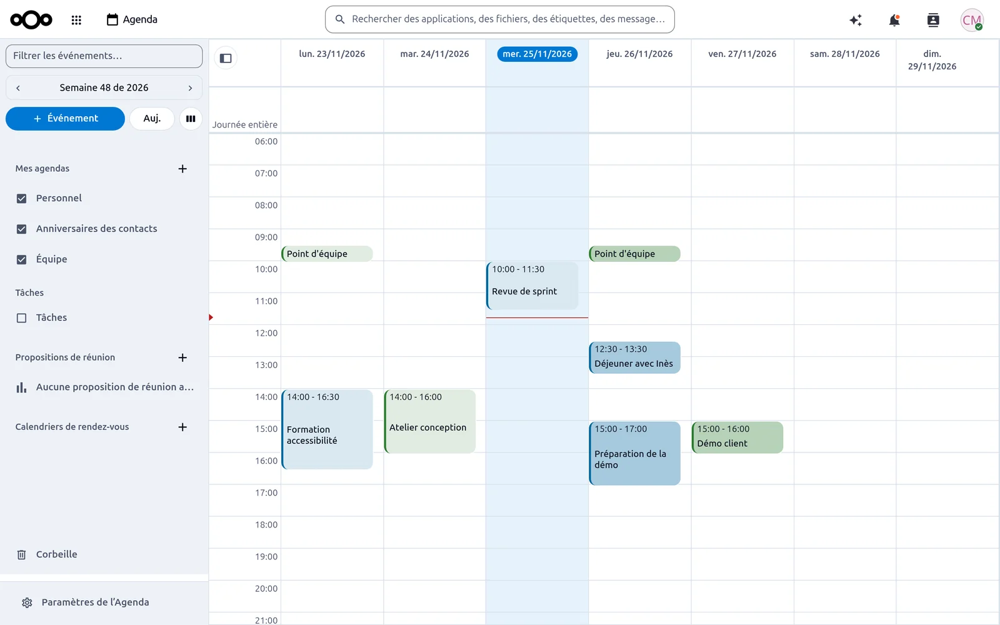 | 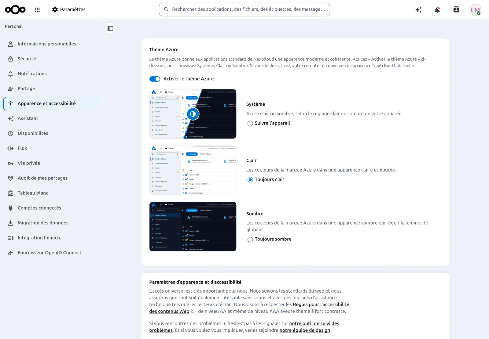 |
| 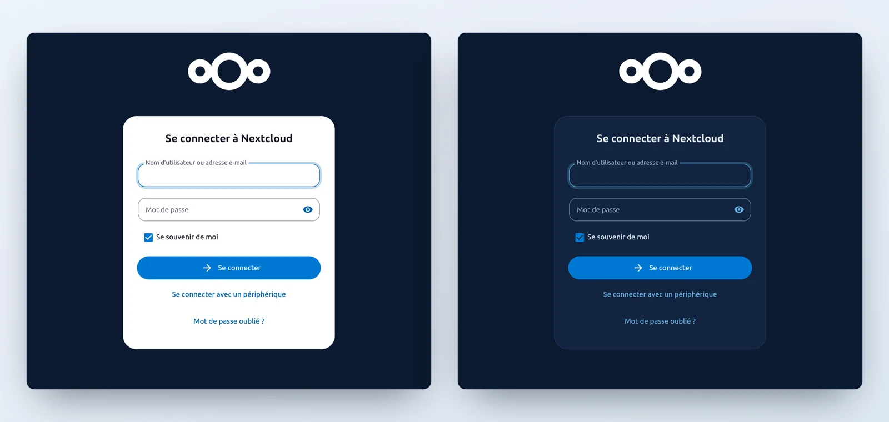 | 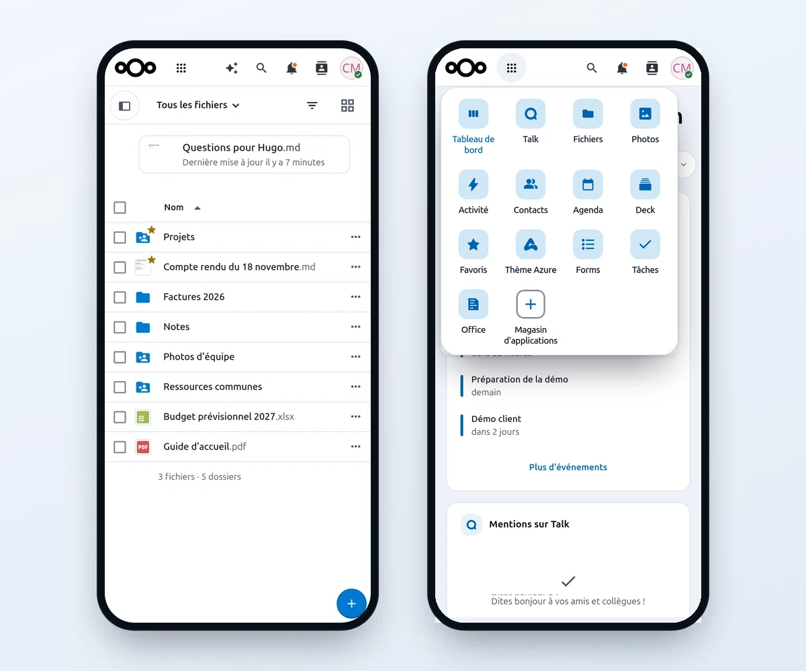 |

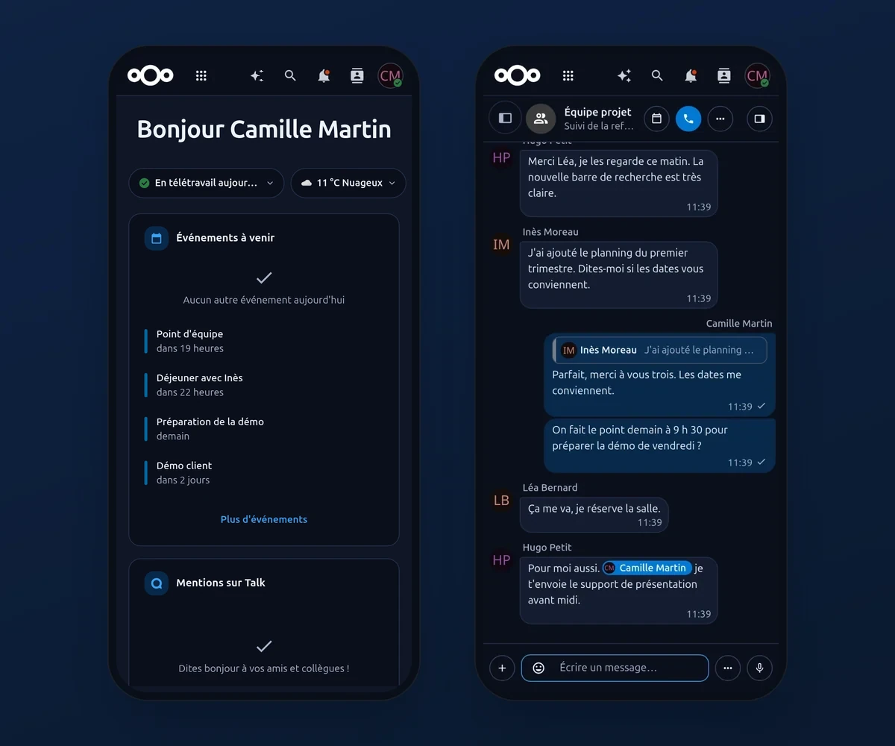

## Compatibilité

| | Pris en charge |
|---|---|
| Nextcloud | 34, 35, 36 (vérifié en totalité sur 34.0.6 et 35.0.3 ; écrans clés contrôlés sur la préversion 36.0.0) |
| PHP | 8.2 à 8.5 |
| Navigateurs | Navigateurs récents basés sur Chromium et Firefox ; Safari non testé |

**Applications testées** (versions dans [docs/certification.md](docs/certification.md)) : Fichiers, Photos, Talk, Agenda (agendas d'abonnement compris), Contacts, Tâches, Deck, Notes, Formulaires, Favoris, Musique, Tableau blanc, Assistant, Context Chat, intégration OpenAI, intégrations GitHub et Immich, ONLYOFFICE, LibreSign, fournisseur OpenID Connect, Share Audit, Transfert de propriété, chiffrement de bout en bout, Text, Activité, tableau de bord, applications de double authentification et toutes les applications livrées avec Nextcloud 34. Les applications sans règle dédiée héritent du thème par les variables de design de Nextcloud.

## Installation

**Depuis l'App Store de Nextcloud** (recommandé) : dans *Applications → Personnalisation*, cherchez **Azure Theme** et choisissez *Télécharger et activer*, ou lancez :

```bash
sudo -u www-data php occ app:install azure_theme
```

Les mises à jour apparaissent ensuite dans la page *Applications* de Nextcloud, comme pour toute autre app.

**Depuis la version publiée sur GitHub :**

```bash
cd /chemin/vers/nextcloud/apps     # ou custom_apps
curl -LO https://github.com/Azure-Informatique/nextcloud-azure-theme/releases/download/v1.1.5/azure_theme-1.1.5.tar.gz
tar xzf azure_theme-1.1.5.tar.gz && rm azure_theme-1.1.5.tar.gz
chown -R www-data:www-data azure_theme
sudo -u www-data php ../occ app:enable azure_theme
```

Le thème est alors actif pour tout le monde et suit le réglage clair ou sombre de chaque appareil. Pour mettre à jour une installation manuelle, remplacez le dossier `azure_theme` par la nouvelle version, puis lancez `occ upgrade`.

**Commandes utiles :**

```bash
occ config:system:set enforce_theme --value=dark      # imposer Azure sombre (ou clair) à tous
occ config:app:set azure_theme app_menu --value=no    # masquer l'entrée du menu des applications
occ config:app:set azure_theme login_style --value=no # page de connexion standard de Nextcloud
occ azure_theme:purge-settings --force                # effacer tous les réglages du thème avant de supprimer l'app
```

**Depuis les sources :** clonez dans `apps/azure_theme`, lancez `make build` (Node.js 22.14 ou plus), puis activez l'app. `make appstore` fabrique l'archive de version.

## Performances

Mesures de référence de la version 1.1.0 face à Nextcloud sans thème : médiane de trois passes alternées sur Nextcloud 34.0.6 avec 300 fichiers, sur des cœurs de processeur dédiés.

| | Sans thème | **Thème Azure 1.1.0** |
|---|---|---|
| Fichiers utilisable (cache chaud) | 6,1 s | **4,6 s** |
| Talk utilisable (cache chaud) | 3,4 s | **3,0 s** |
| Défilement de la liste des fichiers | 16 img/s | **39 img/s** |
| Ouverture de la barre latérale (INP) | 288 ms | **192 ms** |
| Menu des applications (INP) | 216 ms | **24 ms** |
| Saisie dans la recherche (INP) | 208 ms | **72 ms** |

Chaque version suivante est mesurée face à la précédente en passes alternées, et aucune n'a été plus lente. Pour la 1.1.4 : 12 passes alternées face à la 1.1.3 (264 mesures sur 11 écrans, ordinateur et téléphone), aucun ralentissement et quatre gains mesurables, jusqu'à 9,9 % plus vite vers le contenu utile au téléphone ; ses feuilles de style sont aussi plus légères de 158 Ko. Pour la 1.1.5 : passes alternées face à la 1.1.4 sur Nextcloud 34 et 35 (104 mesures sur les cinq écrans corrigés, ordinateur et téléphone), aucun ralentissement.

Comment : la compilation résout chaque sélecteur `:has()` sur un ancêtre (qui fait recalculer à Chromium le style de pages entières à chaque modification), chaque section des paramètres a sa propre petite feuille de style, et les transitions se limitent aux couleurs, à l'opacité et aux transformations. Détails : [docs/certification.md](docs/certification.md).

## Confidentialité

Le thème fonctionne entièrement dans votre Nextcloud et ne charge rien depuis des services externes. Il enregistre la variante choisie par chaque utilisateur (incluse dans la migration de compte de Nextcloud) et deux réglages d'instance (page de connexion, entrée du menu des applications) — aucune donnée personnelle.

## Développement

```bash
make install-deps   # npm + composer
npm run watch       # recompiler les feuilles de style à chaque modification
make lint           # ESLint, Stylelint, analyse PHP, style du code, Psalm
make test           # tests unitaires PHP
```

Tests navigateur (Playwright, sur une instance de **test** uniquement) : `tests/browser/variantes.mjs`, `tests/browser/jetons.mjs`, `tests/browser/parcours.mjs`. La charte graphique est dans [docs/charte.md](docs/charte.md). Journal des modifications : [CHANGELOG.md](CHANGELOG.md).

## Sécurité

Merci de signaler toute faille en privé — voir [SECURITY.md](SECURITY.md).

## Licence

[AGPL-3.0-or-later](LICENSE). La police Ubuntu Sans, fournie sans modification dans `fonts/`, est sous [Ubuntu Font Licence 1.0](fonts/LICENCE-ubuntu-sans.txt) (Canonical Ltd.).

Ce projet est un fork de Nexeno Theme (AGPL-3.0-or-later), adapté et maintenu par Azure Informatique.
