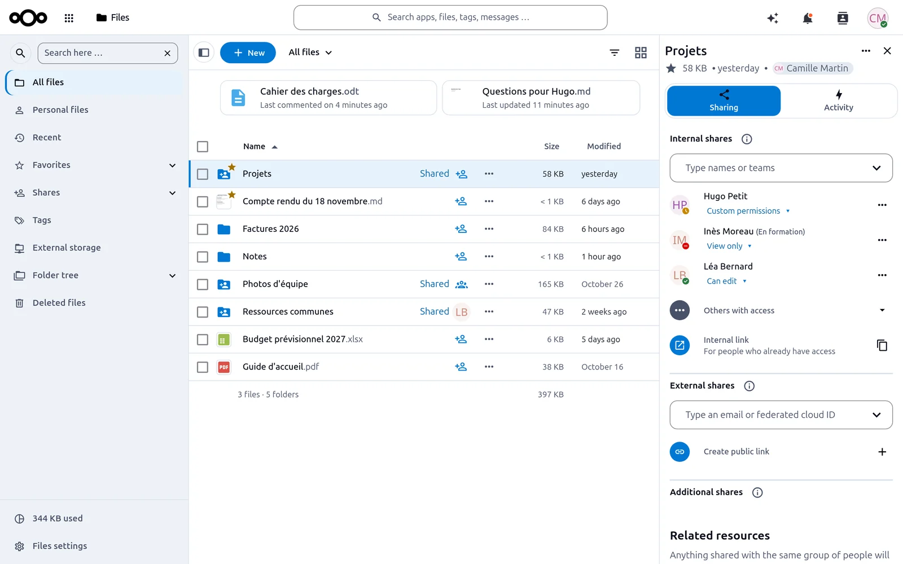
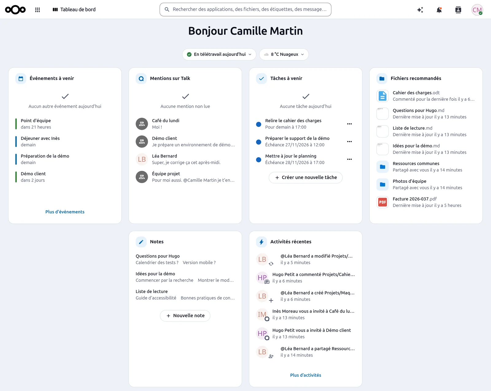
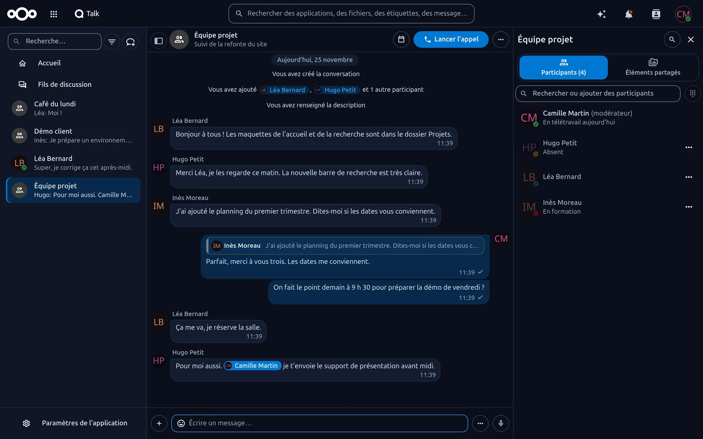
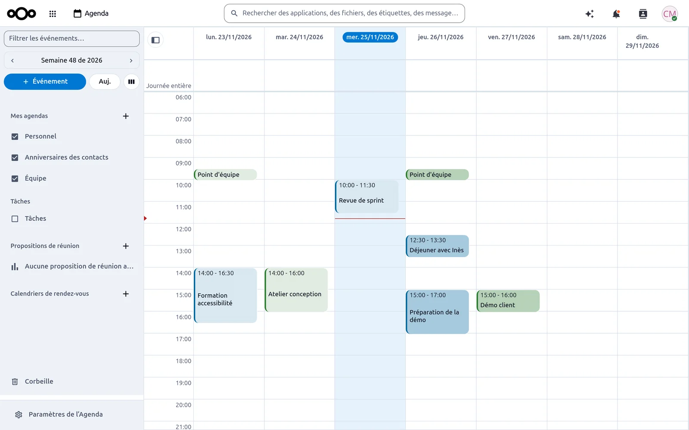
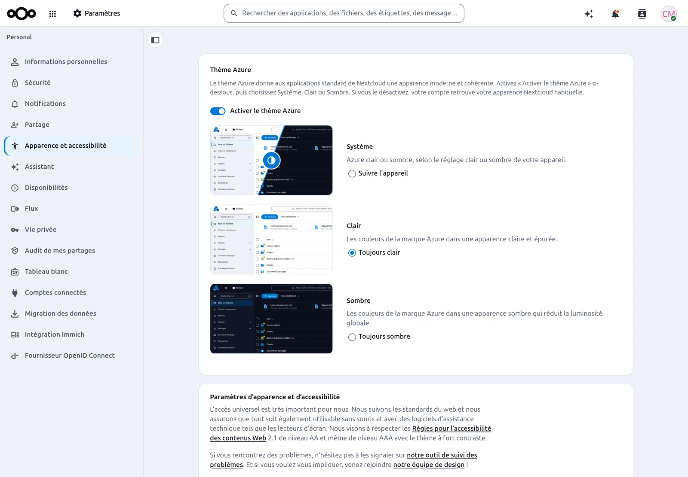
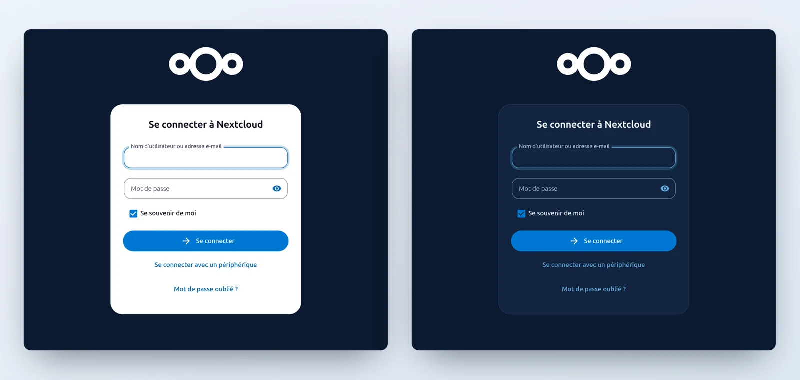
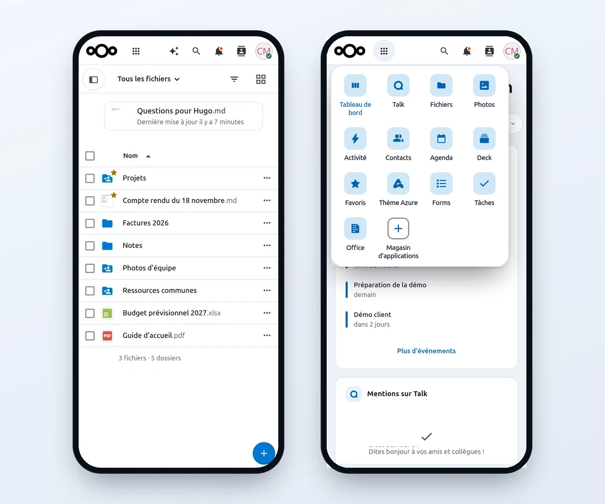
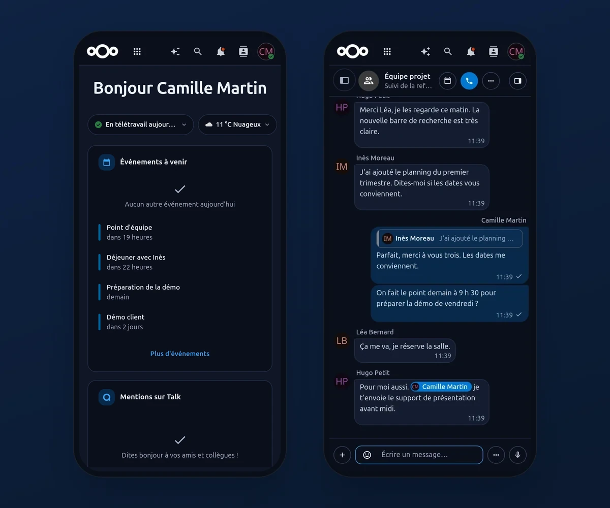
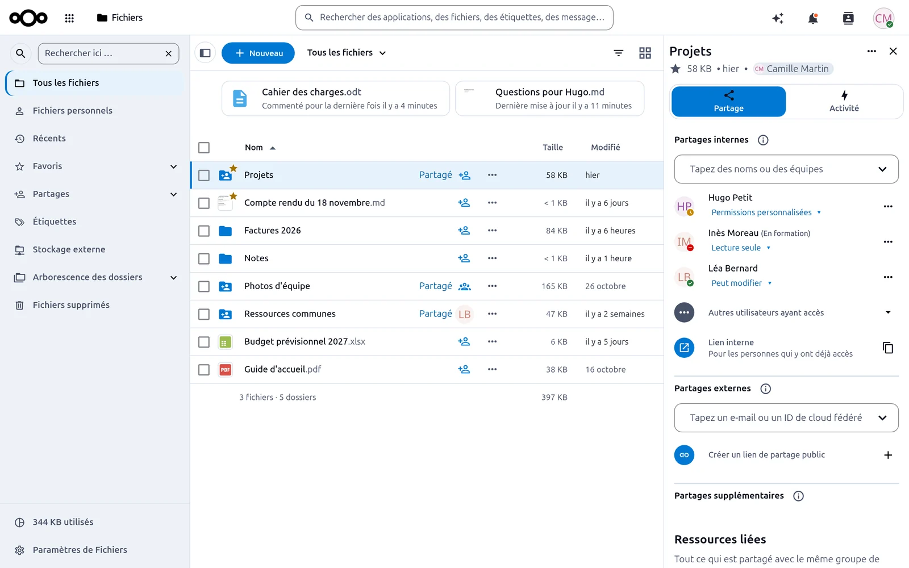
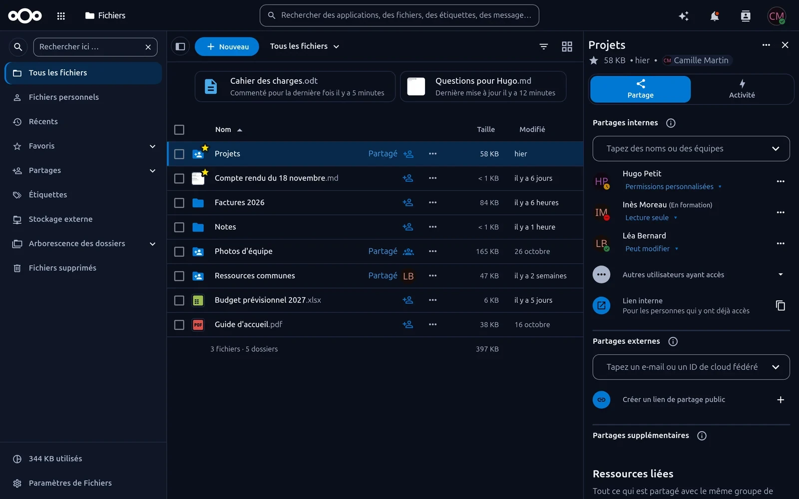

<!--
  - SPDX-FileCopyrightText: 2026 Nexeno contributors
  - SPDX-FileCopyrightText: 2026 Azure Informatique
  - SPDX-License-Identifier: AGPL-3.0-or-later
-->
# Azure Theme for Nextcloud — clean light & dark theme

[](https://github.com/oboeglen/nextcloud-azure-theme/releases/latest)
[](#compatibility)
[](#compatibility)
[](LICENSE)
[](REUSE.toml)

**A complete, modern theme for Nextcloud — light, dark or following the device — that restyles the whole interface without slowing it down.** Files, Talk, Calendar, Photos, the dashboard, every settings page and every public page get one consistent, flat and readable design, on desktop and on mobile.

[Français ↓](#français)




## Highlights

- **Light, dark or system** — *Azure Light*, *Azure Dark* and *System default* (follows the device and its changes). Each user picks a variant in *Personal settings → Appearance and accessibility*; switching is instant, without reloading the page. Admins can impose one variant to everyone with Nextcloud's own `enforce_theme` setting.
- **The whole interface** — header, app menu, navigation, dialogs, sidebars, unified search, notifications, settings and profile pages, app store, login and two-factor pages, public shares, file drop, public forms and appointments, Talk guest pages.
- **Fast** — measured on a real-size instance: as fast as Nextcloud without any theme, and often faster (see [Performance](#performance)). Each page only loads the styles it needs; no costly selectors, no load animations.
- **Mobile-ready** — every screen checked at 1440, 1024, 768, 390 and 360 px: no horizontal overflow, no cut words, 44 px touch targets.
- **Accessible** — WCAG AA contrasts, visible keyboard focus; Nextcloud's high-contrast themes and the OpenDyslexic font keep working.
- **Safe** — public Nextcloud APIs only, no inline script, nothing loaded from outside your server; your own Nextcloud appearance settings are never changed. Disabling the app keeps every setting.
- **Admin options** — keep or remove the Azure login page; show or hide the *Azure Theme* entry in the app menu.
- **Languages** — English and French.

| | |
|---|---|
|  |  |
|  |  |
|  |  |



## Compatibility

| | Supported |
|---|---|
| Nextcloud | 34, 35, 36 (fully certified on 34.0.6; key screens checked on 35.0.3 and 36.0.0 pre-release) |
| PHP | 8.2 to 8.5 |
| Browsers | Current Chromium-based browsers and Firefox; Safari not tested |

**Tested apps** (versions in [docs/certification.md](docs/certification.md)): Files, Photos, Talk, Calendar, Contacts, Tasks, Deck, Notes, Forms, Bookmarks, Music, Whiteboard, Assistant, Context Chat, OpenAI integration, ONLYOFFICE, LibreSign, OpenID Connect provider, Share Audit, end-to-end encryption, Text, Activity, Dashboard, two-factor apps and all apps shipped with Nextcloud 34. Apps without dedicated rules inherit the theme through Nextcloud's design variables.

## Installation

**From the release** (recommended):

```bash
cd /path/to/nextcloud/apps        # or custom_apps
curl -LO https://github.com/oboeglen/nextcloud-azure-theme/releases/latest/download/azure_theme-1.1.0.tar.gz
tar xzf azure_theme-1.1.0.tar.gz && rm azure_theme-1.1.0.tar.gz
chown -R www-data:www-data azure_theme
sudo -u www-data php ../occ app:enable azure_theme
```

The theme is then active for everyone, following each device's light or dark setting.

**Useful commands:**

```bash
occ config:system:set enforce_theme --value=dark      # impose Azure Dark (or light) to everyone
occ config:app:set azure_theme app_menu --value=no    # hide the app-menu entry
occ config:app:set azure_theme login_style --value=no # standard Nextcloud login page
occ azure_theme:purge-settings --force                # erase all theme settings before removing the app
```

**From source:** clone into `apps/azure_theme`, run `make build` (Node.js 22.14+), then enable the app. `make appstore` builds the release archive.

## Performance

Median of three alternating runs (no theme / 1.0.0 / 1.1.0) on Nextcloud 34.0.6 with 300 files, isolated CPU cores:

| | No theme | **Azure Theme 1.1.0** |
|---|---|---|
| Files usable (warm cache) | 6.1 s | **4.6 s** |
| Talk usable (warm cache) | 3.4 s | **3.0 s** |
| Files list scrolling | 16 fps | **39 fps** |
| Opening the sidebar (INP) | 288 ms | **192 ms** |
| App menu (INP) | 216 ms | **24 ms** |
| Typing in search (INP) | 208 ms | **72 ms** |

How: the build resolves every ancestor `:has()` selector (which makes Chromium restyle whole pages on each DOM change), each settings section gets its own small stylesheet, and transitions are limited to colour, opacity and transform. Details: [docs/certification.md](docs/certification.md).

## Privacy

The theme runs entirely inside your Nextcloud and loads nothing from external services. It stores each user's chosen variant (included in Nextcloud account migration) and two instance-wide switches (login page, app-menu entry) — no personal data.

## Development

```bash
make install-deps   # npm + composer
npm run watch       # rebuild stylesheets on change
make lint           # ESLint, Stylelint, PHP lint, code style, Psalm
make test           # 113 PHP unit tests
```

Browser tests (Playwright, on a **test** instance only): `tests/browser/variantes.mjs`, `tests/browser/jetons.mjs`, `tests/browser/parcours.mjs`. The design charter is in [docs/charte.md](docs/charte.md) (French).

## Security

Please report vulnerabilities privately — see [SECURITY.md](SECURITY.md).

## License

[AGPL-3.0-or-later](LICENSE). The Ubuntu Sans font, bundled unmodified in `fonts/`, is under the [Ubuntu Font Licence 1.0](fonts/LICENCE-ubuntu-sans.txt) (Canonical Ltd.).

This project is a fork of Nexeno Theme (AGPL-3.0-or-later), adapted and maintained by Azure Informatique.

---

## Français

### Thème Azure pour Nextcloud — thème clair et sombre

**Un thème complet et moderne pour Nextcloud — clair, sombre ou selon l'appareil — qui habille toute l'interface sans la ralentir.** Fichiers, Talk, Agenda, Photos, tableau de bord, toutes les pages de réglages et toutes les pages publiques reçoivent un design unique, à plat et lisible, sur ordinateur comme sur téléphone.




- **Clair, sombre ou système** : *Azure clair*, *Azure sombre* et *Thème du système* (suit l'appareil). Chacun choisit dans *Paramètres personnels → Apparence et accessibilité*, changement instantané sans rechargement. Un administrateur peut imposer une variante à tous avec le réglage `enforce_theme` de Nextcloud.
- **Toute l'interface** : en-tête, menu des applications, navigation, fenêtres, barres latérales, recherche, notifications, réglages, profils, magasin d'applications, connexion et double authentification, partages publics, formulaires et rendez-vous publics, Talk invité.
- **Rapide** : aussi rapide que Nextcloud sans thème, souvent plus (tableau ci-dessus) ; chaque page ne charge que les styles utiles.
- **Mobile** : chaque écran vérifié de 1440 à 360 px — aucun débordement, aucun mot coupé, cibles tactiles de 44 px.
- **Accessible** : contrastes WCAG AA, focus clavier visible ; contraste élevé et police OpenDyslexic de Nextcloud respectés.
- **Sûr** : API publiques de Nextcloud uniquement, aucun script en ligne, rien de chargé hors de votre serveur ; vos réglages d'apparence Nextcloud ne sont jamais modifiés ; désactiver l'app conserve tous les réglages.
- **Options d'administration** : page de connexion Azure ou standard ; entrée « Thème Azure » du menu des applications affichée ou masquée.
- **Langues** : anglais et français.

**Installation** : voir [Installation](#installation) (mêmes commandes). **Compatibilité** : Nextcloud 34, 35 et 36, PHP 8.2 à 8.5 ; applications testées et versions dans [docs/certification.md](docs/certification.md). **Journal des modifications** : [CHANGELOG.md](CHANGELOG.md). **Sécurité** : [SECURITY.md](SECURITY.md).

Ce projet est un fork de Nexeno Theme (AGPL-3.0-or-later), adapté et maintenu par Azure Informatique.
