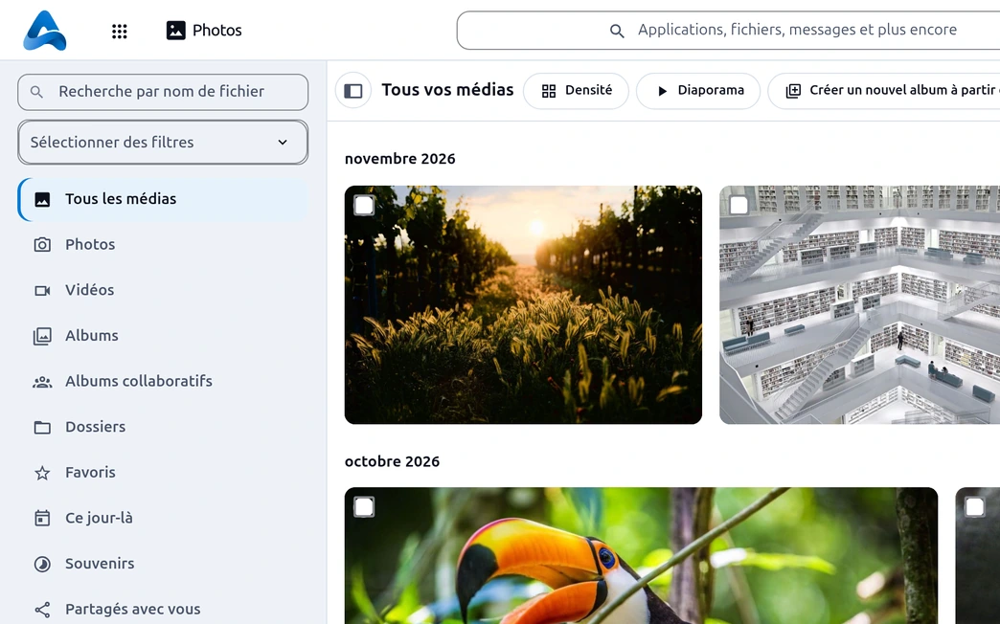
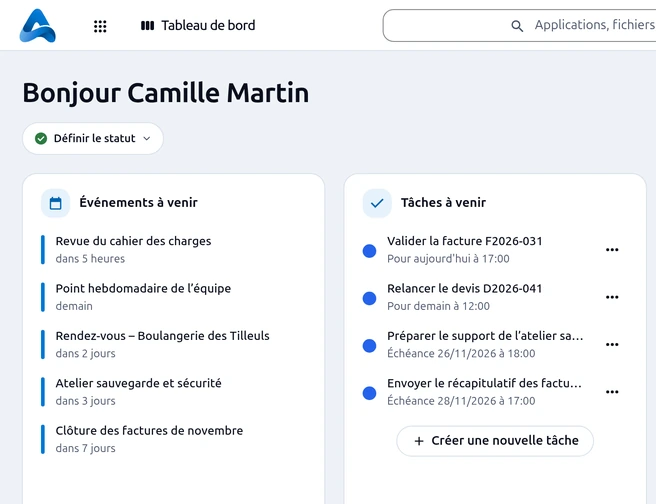
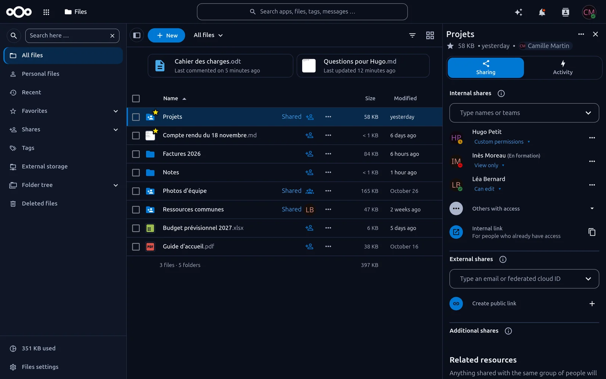

<!--
  - SPDX-FileCopyrightText: 2026 Nexeno contributors
  - SPDX-FileCopyrightText: 2026 Azure Informatique
  - SPDX-License-Identifier: AGPL-3.0-or-later
-->
<div align="center">


# Azure Theme for Nextcloud

### Nextcloud, upgraded by design.

Light, dark and fast — a whole new look, zero slowdown.

[](https://github.com/Azure-Informatique/nextcloud-azure-theme/releases/latest)
[](#compatibility)
[](#compatibility)
[](LICENSE)
[](REUSE.toml)

**English** · [Français](README.fr.md)

</div>

<picture>
  <source media="(prefers-color-scheme: dark)" srcset="src/assets/images/showcase/hero-preview-dark.webp">
  
</picture>

## Highlights

- **Light, dark or system** — *Azure Light*, *Azure Dark* and *System default*, which follows the device and its changes. Each user picks a variant in *Personal settings → Appearance and accessibility*; switching is instant, without reloading the page. Admins can impose one variant to everyone with Nextcloud's own `enforce_theme` setting.
- **The whole interface** — header, app menu, navigation, dialogs, sidebars, unified search, notifications, settings and profile pages, app store, login and two-factor pages, public shares, file drop, public forms and appointments, Talk guest pages.
- **Fast** — as fast as Nextcloud without any theme, and often faster (see [Performance](#performance)). Each page only loads the styles it needs; no costly selectors, no load animations.
- **Mobile-ready** — every screen checked from 1440 to 360 px: no horizontal overflow, no cut words, 44 px touch targets.
- **Accessible** — WCAG AA contrasts and visible keyboard focus; Nextcloud's high-contrast themes and the OpenDyslexic font keep working.
- **Safe** — public Nextcloud APIs only, no inline script, nothing loaded from outside your server; your own Nextcloud appearance settings are never changed, and disabling the app keeps every setting.
- **Admin options** — keep or remove the Azure login page; show or hide the *Azure Theme* entry in the app menu.
- **Languages** — English and French.

## A look around

<table>
  <tr>
    <td width="50%"><picture><source media="(prefers-color-scheme: dark)" srcset="src/assets/images/showcase/files-dark.webp"></picture></td>
    <td width="50%"><picture><source media="(prefers-color-scheme: dark)" srcset="src/assets/images/showcase/photos-dark.webp"></picture></td>
  </tr>
  <tr>
    <td><picture><source media="(prefers-color-scheme: dark)" srcset="src/assets/images/showcase/dashboard-dark.webp"></picture></td>
    <td><picture><source media="(prefers-color-scheme: dark)" srcset="src/assets/images/showcase/office-dark.webp"></picture></td>
  </tr>
  <tr>
    <td colspan="2" align="center"><picture><source media="(prefers-color-scheme: dark)" srcset="src/assets/images/showcase/appstore-dark.webp"></picture></td>
  </tr>
</table>

## Screenshots

Real captures of Nextcloud 34 with the theme, in English, on a test instance with fictitious data.

| Light | Dark |
|---|---|
|  |  |

More screenshots (dashboard, Talk, Calendar, settings, login page, mobile) are in the [French README](README.fr.md#captures).

## Compatibility

| | Supported |
|---|---|
| Nextcloud | 34, 35, 36 (fully certified on 34.0.6; key screens checked on 35.0.3 and 36.0.0 pre-release) |
| PHP | 8.2 to 8.5 |
| Browsers | Current Chromium-based browsers and Firefox; Safari not tested |

**Tested apps** (versions in [docs/certification.md](docs/certification.md)): Files, Photos, Talk, Calendar (including subscribed calendars), Contacts, Tasks, Deck, Notes, Forms, Bookmarks, Music, Whiteboard, Assistant, Context Chat, OpenAI integration, GitHub and Immich integrations, ONLYOFFICE, LibreSign, OpenID Connect provider, Share Audit, Ownership transfer, end-to-end encryption, Text, Activity, Dashboard, two-factor apps and all apps shipped with Nextcloud 34. Apps without dedicated rules inherit the theme through Nextcloud's design variables.

## Installation

**From the release** (recommended):

```bash
cd /path/to/nextcloud/apps        # or custom_apps
curl -LO https://github.com/Azure-Informatique/nextcloud-azure-theme/releases/latest/download/azure_theme-1.1.3.tar.gz
tar xzf azure_theme-1.1.3.tar.gz && rm azure_theme-1.1.3.tar.gz
chown -R www-data:www-data azure_theme
sudo -u www-data php ../occ app:enable azure_theme
```

The theme is then active for everyone, following each device's light or dark setting. To update, replace the `azure_theme` folder with the new release and run `occ upgrade`.

**Useful commands:**

```bash
occ config:system:set enforce_theme --value=dark      # impose Azure Dark (or light) to everyone
occ config:app:set azure_theme app_menu --value=no    # hide the app-menu entry
occ config:app:set azure_theme login_style --value=no # standard Nextcloud login page
occ azure_theme:purge-settings --force                # erase all theme settings before removing the app
```

**From source:** clone into `apps/azure_theme`, run `make build` (Node.js 22.14+), then enable the app. `make appstore` builds the release archive.

## Performance

Median of three alternating runs (no theme / 1.0.0 / 1.1.0) on Nextcloud 34.0.6 with 300 files, isolated CPU cores; every later release is measured against the previous one with no slowdown:

| | No theme | **Azure Theme 1.1** |
|---|---|---|
| Files usable (warm cache) | 6.1 s | **4.6 s** |
| Talk usable (warm cache) | 3.4 s | **3.0 s** |
| Files list scrolling | 16 fps | **39 fps** |
| Opening the sidebar (INP) | 288 ms | **192 ms** |
| App menu (INP) | 216 ms | **24 ms** |
| Typing in search (INP) | 208 ms | **72 ms** |

How: the build resolves every ancestor `:has()` selector (which makes Chromium restyle whole pages on each DOM change), each settings section gets its own small stylesheet, and transitions are limited to colour, opacity and transform. Details: [docs/certification.md](docs/certification.md).

## Privacy

The theme runs entirely inside your Nextcloud and loads nothing from external services. It stores each user's chosen variant (included in Nextcloud account migration) and two instance-wide switches (login page, app-menu entry) — no personal data.

## Development

```bash
make install-deps   # npm + composer
npm run watch       # rebuild stylesheets on change
make lint           # ESLint, Stylelint, PHP lint, code style, Psalm
make test           # PHP unit tests
```

Browser tests (Playwright, on a **test** instance only): `tests/browser/variantes.mjs`, `tests/browser/jetons.mjs`, `tests/browser/parcours.mjs`. The design charter is in [docs/charte.md](docs/charte.md) (French). Changes: [CHANGELOG.md](CHANGELOG.md).

## Security

Please report vulnerabilities privately — see [SECURITY.md](SECURITY.md).

## License

[AGPL-3.0-or-later](LICENSE). The Ubuntu Sans font, bundled unmodified in `fonts/`, is under the [Ubuntu Font Licence 1.0](fonts/LICENCE-ubuntu-sans.txt) (Canonical Ltd.).

This project is a fork of Nexeno Theme (AGPL-3.0-or-later), adapted and maintained by Azure Informatique.
